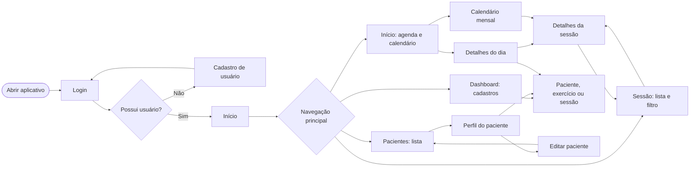
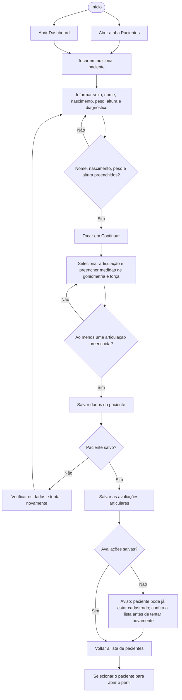
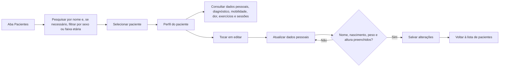
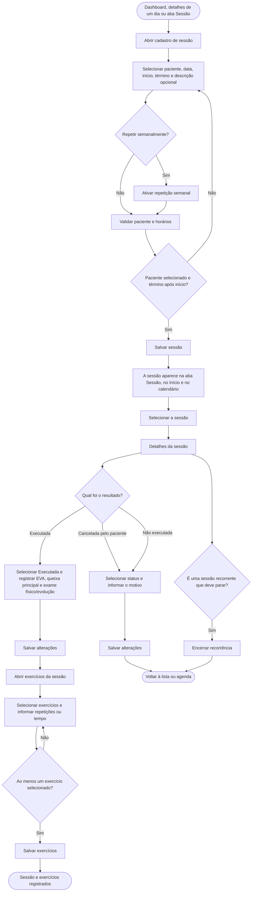
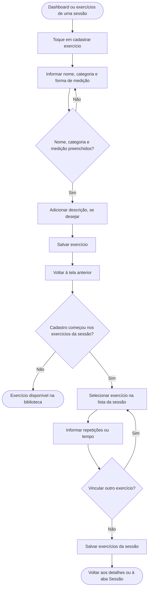

# Fluxograma de usabilidade do PhysioCore

Este documento mostra como navegar pelo aplicativo e concluir os principais processos: acesso, cadastro e consulta de pacientes, agendamento e registro de sessões, e gestão de exercícios.

## 1. Visão geral da navegação

As quatro opções da barra inferior ficam disponíveis nas telas principais: **Início**, **Dashboard**, **Sessão** e **Pacientes**. O calendário mensal é aberto pelo ícone de calendário na tela Início. Para voltar de telas de detalhe ou formulário, use o botão de voltar do próprio aplicativo.

## 2. Cadastrar paciente

O cadastro começa pelos dados pessoais e segue para a avaliação de goniometria e força. É necessário preencher nome, data de nascimento, peso e altura na primeira etapa e registrar ao menos uma articulação na segunda.

### Consultar ou editar paciente

No perfil, as sessões do paciente também podem ser abertas para consultar seus detalhes. A evolução da dor (EVA) e dos exercícios é apresentada quando há registros disponíveis.

## 3. Agendar e acompanhar sessão

Uma sessão pode ser criada pelo Dashboard, pelo botão de adicionar nos detalhes de um dia, ou pela tela Sessão. Na criação, escolha paciente, data, horários e, se necessário, repetição semanal.

Para marcar uma sessão como **Executada**, os três registros clínicos são obrigatórios: EVA, queixa principal e exame físico/evolução. Depois, vincule pelo menos um exercício e informe sua medida (repetições ou tempo). Para **Cancelada pelo paciente** ou **Não executada**, informe o motivo; não é necessário preencher os campos clínicos. Sessões recorrentes podem ser encerradas pelos detalhes da sessão, sem apagar as ocorrências anteriores.

## 4. Cadastrar e vincular exercícios

## 5. Consultar agenda e sessões

- **Início:** percorra os dias e selecione um para ver as sessões daquele dia. Nos detalhes do dia, toque em uma sessão para abrir seu registro ou use **Cadastrar nova sessão**.
- **Calendário:** abra pelo ícone de calendário no Início, navegue entre meses e toque em uma sessão para ver seus detalhes.
- **Sessão:** pesquise pelo nome do paciente e/ou filtre por data; selecione um resultado para consultar ou atualizar o status.
- **Pacientes:** pesquise e filtre a lista, abra o perfil e consulte dados clínicos, avaliações, evolução e sessões vinculadas.

## 6. Resumo dos principais caminhos

| Objetivo | Caminho principal |
| --- | --- |
| Criar usuário | Login → Cadastro → Login |
| Cadastrar paciente | Pacientes ou Dashboard → Novo paciente → Dados pessoais → Goniometria e força → Salvar |
| Editar paciente | Pacientes → Perfil → Editar → Salvar |
| Agendar sessão | Dashboard, Início ou Sessão → Cadastrar sessão → Salvar |
| Registrar atendimento | Início, Calendário ou Sessão → Detalhes da sessão → Executada → Registro clínico → Exercícios → Salvar |
| Marcar ausência/cancelamento | Detalhes da sessão → Cancelada pelo paciente ou Não executada → Informar motivo → Salvar |
| Cadastrar exercício | Dashboard ou exercícios da sessão → Cadastrar exercício → Salvar |
| Encerrar sessão semanal | Detalhes da ocorrência recorrente → Encerrar recorrência |
